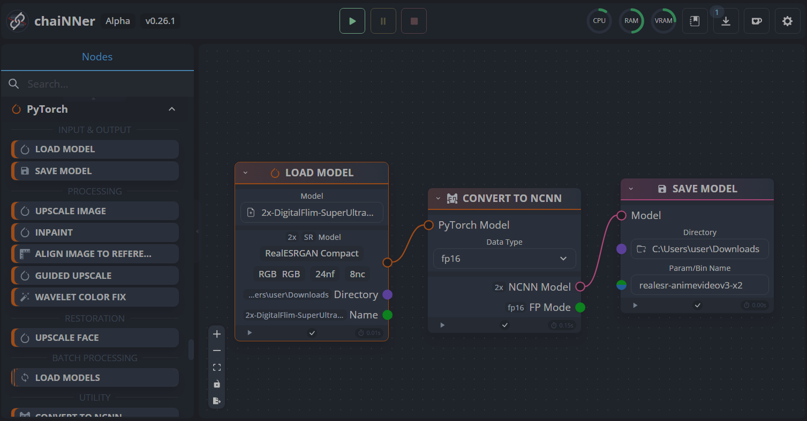

# 1080p Lecture Video Enhancement Guide

A local, GPU-accelerated batch workflow for converting poorly recorded lecture recordings into high-contrast, sharp MP4 videos with clear whiteboard handwriting and normalized voice audio.
This concept works for any other video file type supported by FFmpeg, including `.MTS`, `.MP4`, `.MOV`, `.MKV`, `.AVI`, and similar formats.
Key actions: Human-voice boost, noise suppression, and whiteboard writing enhancement. 

---

## 1. Tools & Model Citations

* **FFmpeg** — Used for deinterlacing, contrast/whiteboard curve adjustment, unsharp masking, and audio filtering/normalization (`ffmpeg.org`).
* **Video2X (v6.4.0 CLI / Qt6)** — Used for NCNN-Vulkan GPU inference and hardware-accelerated NVENC encoding (`github.com/k4yt3x/video2x`).
* **AI Restoration Model (`2x-DigitalFlim-SuperUltraCompact`)** — Lightweight `SRVGGNetCompact` deblur/restoration architecture sourced from OpenModelDB (`https://openmodeldb.info/models/2x-DigitalFlim-SuperUltraCompact`).
---------
* **chaiNNer** — Used to convert PyTorch `.pth` super-resolution models into `fp16` NCNN `.param` and `.bin` binaries (`github.com/chaiNNer-org/chaiNNer`). Needs the Pytorch, NCNN, and ONNX dependencies.  ONLY NEEDED FOR CUSTOM BUILDS
---

## 2. System & Software Prerequisites

### Hardware
* **GPU:** NVIDIA GPU with Vulkan and NVENC support (tested on **NVIDIA GeForce RTX 3060 Ti, 8GB VRAM**).

### Software Setup
1. **FFmpeg:** Installed and added to your Windows System `PATH` so `ffmpeg` can be invoked from any PowerShell terminal.
2. **Video2X 6.4.0:** Installed (e.g., `C:\Program Files\Video2X Qt6\video2x.exe`).
3. **chaiNNer (with ONNX & NCNN dependencies):** Required only once to convert `.pth` weights to NCNN format. (Unnecessary)

---

## 3. Custom Model Installation (Slot-Swap Method)

Video2X 6.4.0 enforces a strict model-name whitelist in its CLI and GUI (`validators.cpp`). To use `2x-DigitalFlim-SuperUltraCompact` without triggering invalid argument errors or stride-mismatch artifacts, use the slot-swap method described below.

1. **Convert to NCNN (`fp16`):**
   * Open **chaiNNer** (ensure the **ONNX** dependency is installed via the top-right Dependency Manager).
   * Connect **Load Model** (`2x-DigitalFlim-SuperUltraCompact.pth`) → **Convert To NCNN** (set **Data Type** to `fp16`) → **Save Model**.
   * 
2. **Verify I/O Layer Names:**
   * Open the generated `.param` file in Notepad. Confirm the input blob is named `data` and the final output blob is named `output`.
3. **Install into Video2X:**
   * Rename the two files to:
     * `realesr-animevideov3-x2.param`
     * `realesr-animevideov3-x2.bin`
   * Place both files inside your Video2X Real-ESRGAN models directory (default: `C:\Program Files\Video2X Qt6\models\realesrgan\`).

---

## 4. Step 1: Audio & Video Pre-Processing (FFmpeg)

This stage deinterlaces the source video, boosts whiteboard contrast and marker legibility, and cleans/normalizes lecture speech before AI enhancement. This works with `.MTS`, `.MP4`, `.MOV`, `.MKV`, `.AVI`, and other FFmpeg-supported inputs.

### Single-File Command
```powershell
ffmpeg -y -i "INPUT_LECTURE.mp4" `
    -vf "yadif=0:-1:0,curves=all='0/0 0.25/0.18 0.75/0.88 1/1',unsharp=5:5:0.8:3:3:0.4" `
    -af "highpass=f=80,lowpass=f=12000,afftdn=nf=-25,loudnorm=I=-16:TP=-1.5:LRA=11" `
    -c:v h264_nvenc -rc vbr -cq 18 -preset p5 `
    -c:a aac -b:a 192k `
    "OUTPUT_ready.mp4"
```

### Filter Breakdown
* **Video (`-vf`):**
  * `yadif=0:-1:0`: Deinterlaces 1080i source frames to progressive 1080p when needed.
  * `curves=...`: Darkens faint marker ink (`0.25 -> 0.18`) while brightening the off-white board background (`0.75 -> 0.88`).
  * `unsharp=5:5:0.8:3:3:0.4`: Pre-sharpens fine handwriting edges prior to neural network inference.
* **Audio (`-af`):**
  * `highpass=f=80,lowpass=f=12000`: Removes HVAC/room rumble below 80 Hz and high-frequency hiss above 12 kHz.
  * `afftdn=nf=-25`: Applies FFT-based stationary background noise reduction.
  * `loudnorm=I=-16:TP=-1.5:LRA=11`: Normalizes lecture speech to standard `-16 LUFS` loudness.

---

## 5. Step 2: AI Enhancement & Output Resolution Options (Video2X)

Because `2x-DigitalFlim-SuperUltraCompact` is a `2x` model, running it with `-s 2` matches the internal NCNN memory stride. To change the final output resolution, **always keep `-s 2` fixed** and adjust only the output dimensions (`-w` and `-h`).

### Common Target Resolutions (16:9 Aspect Ratio)

| Target Resolution | Video2X CLI Flags | Recommended Encoder (`-c`) | Notes |
| :--- | :--- | :--- | :--- |
| **720p (HD)** | `-s 2 -w 1280 -h 720` | `h264_nvenc` | Fastest encoding, smallest file size; still retains AI-sharpened whiteboard edges. |
| **1080p (Full HD)** | `-s 2 -w 1920 -h 1080` | `h264_nvenc` | **Default.** Supersamples the 2x AI output down to crisp native 1080p. |
| **1440p (2K QHD)** | `-s 2 -w 2560 -h 1440` | `h264_nvenc` | Good middle ground for crisp text on 2K monitors without full 4K file sizes. |
| **2160p (Native 4K)** | `-s 2` *(omit `-w` and `-h`)* | `h264_nvenc` or `hevc_nvenc` | Outputs the raw 2x upscaled resolution (`3840×2160` from a 1080p source). `hevc_nvenc` is recommended for smaller files at 4K. |

### Rules When Changing Resolution
* **Never change `-s 2`:** Because `realesr-animevideov3-x2` is a `2x` model, changing `-s` to `1`, `3`, or `4` will cause buffer stride misalignment (horizontal yellow stripes and tiled duplication).
* **Preserve Aspect Ratio:** If your source video is not standard 16:9 (e.g., 4:3 or 16:10), calculate the exact proportional width and height—or pass `-1` for one dimension (such as `-w -1 -h 1440`).
* **H.264 4096px Width Limit:** `h264_nvenc` supports up to `4096×4096` (so standard 4K `3840×2160` works fine), but if your custom width ever exceeds `4096` pixels, switch `-c h264_nvenc` to `-c hevc_nvenc` or reduce the target width.

### 5-Second Verification Test (Optional)
Before running a multi-hour batch, slice a 5-second clip to verify speed, resolution, and visual alignment:
```powershell
ffmpeg -y -i "課程-1_ready.mp4" -t 5 -c copy "test_5s.mp4"

& "C:\Program Files\Video2X Qt6\video2x.exe" -i "test_5s.mp4" -o "test_5s_out.mp4" `
    -p realesrgan --realesrgan-model realesr-animevideov3 -s 2 -w 1920 -h 1080 `
    --realesrgan-gpu-threads 2 `
    -c h264_nvenc -e rc=vbr -e cq=18 -e preset=p5
```

---

## 6. Complete End-to-End Batch Script (PowerShell)

Save this script as `process_lectures.ps1` inside your video folder, customize the variables in the **CONFIGURATION** block at the top (including `$TargetWidth` and `$TargetHeight`), and run it in PowerShell. It accepts multiple input formats and automatically processes any video file type supported by FFmpeg in the source directory.

```powershell
# ==============================================================================
# CONFIGURATION - Edit these variables to match your environment & target size
# ==============================================================================
$V2XPath      = "C:\Program Files\Video2X Qt6\video2x.exe"
$InputDir     = "D:\Lectures\Raw_Video"      # Folder containing source videos
$OutputDir    = "D:\Lectures\Final_Output"   # Folder where final MP4s will be saved
$KeepTemp     = $false                         # Set to $true to keep *_ready.mp4 files

# Supported input types: .mts, .m2ts, .mp4, .mov, .mkv, .avi, .wmv, .ts, .mxf, .mpg, .mpeg
$SupportedExts = @(
    ".MTS", ".M2TS", ".MP4", ".MOV", ".MKV", ".AVI", ".WMV",
    ".TS", ".MXF", ".MPG", ".MPEG", ".FLV", ".WEBM"
)

# Resolution Settings (Set both to 0 for native 2x / 4K output without scaling)
$TargetWidth  = 1920                         # Examples: 1280 (720p), 1920 (1080p), 2560 (1440p), 0 (Native 4K)
$TargetHeight = 1080                         # Examples: 720 (720p), 1080 (1080p), 1440 (1440p), 0 (Native 4K)
$VideoEncoder = "h264_nvenc"                 # Use "h264_nvenc" or "hevc_nvenc" (recommended for 4K)
# ==============================================================================

if (-not (Test-Path $V2XPath)) {
    Write-Error "Video2X executable not found at: $V2XPath"
    exit 1
}

if (-not (Test-Path $OutputDir)) {
    New-Item -ItemType Directory -Path $OutputDir | Out-Null
}

$videoFiles = Get-ChildItem -Path $InputDir -File | Where-Object {
    $SupportedExts -contains $_.Extension.ToUpperInvariant()
}

if ($videoFiles.Count -eq 0) {
    Write-Warning "No supported video files found in $InputDir"
    exit 0
}

foreach ($file in $videoFiles) {
    $baseName  = $file.BaseName
    $readyFile = Join-Path $OutputDir "$($baseName)_ready.mp4"
    $resLabel  = if ($TargetWidth -gt 0 -and $TargetHeight -gt 0) { "$($TargetHeight)p" } else { "4K_native" }
    $finalFile = Join-Path $OutputDir "$($baseName)_final_$($resLabel).mp4"

    Write-Host "`n========================================================" -ForegroundColor Cyan
    Write-Host "[1/2] FFmpeg Audio & Contrast Prep: $($file.Name)" -ForegroundColor Green
    Write-Host "========================================================" -ForegroundColor Cyan

    ffmpeg -y -i $file.FullName `
        -vf "yadif=0:-1:0,curves=all='0/0 0.25/0.18 0.75/0.88 1/1',unsharp=5:5:0.8:3:3:0.4" `
        -af "highpass=f=80,lowpass=f=12000,afftdn=nf=-25,loudnorm=I=-16:TP=-1.5:LRA=11" `
        -c:v h264_nvenc -rc vbr -cq 18 -preset p5 `
        -c:a aac -b:a 192k `
        $readyFile

    if (-not (Test-Path $readyFile)) {
        Write-Warning "FFmpeg failed for $($file.Name). Skipping Video2X step."
        continue
    }

    Write-Host "`n========================================================" -ForegroundColor Cyan
    Write-Host "[2/2] Video2X AI Enhancement ($resLabel): $baseName" -ForegroundColor Green
    Write-Host "========================================================" -ForegroundColor Cyan

    $v2xArgs = @(
        "-i", $readyFile,
        "-o", $finalFile,
        "-p", "realesrgan",
        "--realesrgan-model", "realesr-animevideov3",
        "-s", "2"
    )

    if ($TargetWidth -gt 0 -and $TargetHeight -gt 0) {
        $v2xArgs += @("-w", $TargetWidth, "-h", $TargetHeight)
    }

    $v2xArgs += @(
        "--realesrgan-gpu-threads", "2",
        "-c", $VideoEncoder,
        "-e", "rc=vbr",
        "-e", "cq=18",
        "-e", "preset=p5"
    )

    & $V2XPath @v2xArgs

    if ((Test-Path $finalFile) -and (-not $KeepTemp)) {
        Remove-Item $readyFile -Force
    }
}

Write-Host "`nBatch processing complete! Files saved to: $OutputDir" -ForegroundColor Green
```

---

## 7. Troubleshooting Reference

| Symptom | Cause | Fix |
| :--- | :--- | :--- |
| `the argument for option 'realesrgan-model' is invalid` | Custom model name rejected by Video2X 6.4.0 whitelist. | Rename model files to `realesr-animevideov3-x2.param` / `.bin` and pass `--realesrgan-model realesr-animevideov3` as shown in the command. |
| Horizontal yellow stripes or tiled duplication | Scale mismatch (e.g., changing `-s 2` to `-s 1` or `-s 4`). | Always keep `-s 2` for `2x` models and control output dimensions via `-w` and `-h`. |
| Extremely slow speed (`< 0.5 fps`) | Heavy 23-block ESRGAN architecture saturating compute shaders. | Use a `Compact` (`SRVGGNetCompact`) model such as `2x-DigitalFlim-SuperUltraCompact` (~10–15 fps on RTX 3060 Ti depending on resolution). |
| `unrecognised option '--realesrgan-gpu-threads'` | Minor build flag difference in Video2X CLI. | Remove `"--realesrgan-gpu-threads", "2",` from `$v2xArgs` in the script. |
| No files processed | Input directory contains unsupported formats or incorrect extension case. | Add the file extension to `$SupportedExts` or keep the same extension as your source, e.g., `.MP4`, `.MOV`, `.MTS`. |

